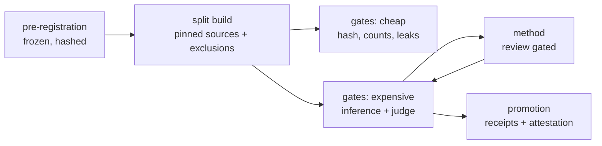

<div align="center">

# WeightSpaceAbliteration

**A refusal is a direction until something measures it.**

<sub>Pre-registered · split frozen · methods not yet admitted · no result yet</sub>

[](LICENSE)
[](pyproject.toml)
[](docs/README.md)

</div>

This repository asks one question and refuses to answer it early:

> Can a weight-space edit remove the refusal direction from an instruction-tuned language model — such
> that, after the edit, a linear probe on the base model's activations no longer separates harmful from
> harmless prompts beyond its null-control and permutation baselines on held-out categories, while
> attack success on a held-out harmful set reaches a pre-registered ceiling at a pre-registered
> capability cost?

Two things make it worth publishing before there is an answer. The question is written so that **no**
is a real outcome, and everything that could otherwise be adjusted after seeing the numbers — the
split, the judges, the endpoints, the margin, the uncertainty method — was fixed and hashed first.

## Status

| component | state | evidence |
|---|---|---|
| Pre-registration | **frozen**, 22 answers | `runs/20261107T112342Z-weightspace-abliteration/ledger.jsonl` entry 0 |
| Literature basis | recorded, 14 lookups | `runs/…/paper_lookups/`, entries 1–14 |
| Split | **built and hashed**, 12 arms | `runs/…/splits/manifest.json`, entries 15–16 |
| Cheap gates | 3 of 3 exercised | `runs/…/receipts/` |
| Expensive gates | 8 implemented, **none run** | `harness/gates.py` |
| Methods | **none admitted**; development in a sandbox | `harness/methods/base.py` refuses every name, `require_admitted()` refuses candidate evaluation |
| Results | **none** | — |
| Execution host | not provisioned | `base_model_revision` carries the TODO |

Four of the eight expensive gates currently read split arms the builder does not yet emit
(`harmless`, `over_refusal`, `probe_pos`, `probe_neg`). That is a known defect, recorded rather than
hidden: those gates cannot run until the builder is extended.

## What is frozen

These cannot change without starting a new run. The ledger's first entry holds their digest
(`c722ba65…`), and `gdkit.promote` refuses a run whose answers drifted from it.

- The study question, and the claim type (`safety`).
- The derivation arm and the evaluation arms, with their exclusions.
- The primary endpoint and its decision rule: **3.8% residual refusal**, applied to the built arm.
- The large replication arm and its rule: **3.8% residual refusal**, applied to the built arm.

> Decision rules are carried as rates, not counts. The pre-registration fixed 3.8% and the first build
> made it ≤12/313 and ≤631/16,612; the exclusion instrument was then changed from MiniLM to
> bge-small-en-v1.5, which materially changed the denominators, so the rules were restated as
> **≤11/293** and **≤594/15,640** and recorded in `runs/…/decision_rules.json` (ledger entry 17).
> The rate did not move. The instrument did.
- The capability suite, the per-task margin, the suite mean, and the GSM8K gap.
- The over-refusal threshold: **10%**.
- The uncertainty method, including the judge-noise correction and the power statement.
- The two judges, by revision.
- Who signs attestations.

## What is open

- **The method.** `harness/methods/base.py` defines the contract and implements nothing.
  `load_method()` raises for all three reserved names. A method is admitted only by review, recorded
  in one ledger entry; see [`harness/methods/README.md`](harness/methods/README.md).
- **The host.** GPU model, VRAM and count are recorded when the machine exists, as their own ledger
  entry, not as an edit to a frozen answer.
- **Results.** There are none.

## Pipeline



Nothing downstream may redefine what is measured. A method may change weights; it may not change the
endpoint, the split, the judges or the margin.

## Quick start

CPU only, no model required:

```bash
python -m harness.gates --run runs/20261107T112342Z-weightspace-abliteration --dry-run
python -m harness.gates --run runs/20261107T112342Z-weightspace-abliteration --smoke
python -m harness.gates --run runs/20261107T112342Z-weightspace-abliteration --gate split_integrity
```

`--smoke` checks every gate's inputs without loading a model. Nine gates report ready; two are blocked
on the output of earlier gates by design. That is the cheapest possible way to find out a gate cannot
run.

Rebuilding the split from pinned sources (fetches the corpora, then hashes them):

```bash
python harness/build_splits.py --run-id 20261107T112342Z-weightspace-abliteration
```

A run with a GPU additionally needs `harness.json` in the run directory — model, parent, both judges,
capability tasks — which is where the host TODO lives today.

## Conducting a run

Every run follows [`docs/protocol/RUN_PROTOCOL.md`](docs/protocol/RUN_PROTOCOL.md): freeze the answers,
record the machine, build the split, run the gates. The harness refuses out-of-order steps, and a
refusal names the rule it enforces and the command that satisfies it. A refusal is a protocol event,
handled per the deviation section of that document — never worked around.

```bash
python -m harness.preflight runs/<id>          # what the run is still missing
python scripts/verify_ledger.py                # chain integrity across all runs
```

The index, including every rule and the code that enforces it, is
[`docs/protocol/README.md`](docs/protocol/README.md).

## Data policy

The corpora are **not redistributed**. The repository publishes dataset identifiers, revisions,
sha256 hashes and item-level exclusion lists, and fetches the rows at build time. This follows from
the pre-registration and from the licences: HarmBench and AdvBench are MIT, Salad-Data is Apache-2.0,
and the benign arm inherits CC BY-NC 4.0 from Alpaca and is never republished.

`datasets/inventory/` is the auditable part: every dataset considered, its verified revision, licence,
size, and whether it was admitted, with the measurements behind each verdict.

## Repository map

| path | what lives there |
|---|---|
| `.gdkit/project.yaml` | the frozen pre-registration |
| `interview/` | the question set the pre-registration was taken from |
| `harness/` | gate registry, split builder, method contract |
| `harness/methods/` | the method interface and review checklist — deliberately unimplemented |
| `tools/` | provenance, leakage and verification utilities |
| `datasets/inventory/` | every dataset audited, with revisions and overlap measurements |
| `runs/<run_id>/` | ledger, receipts, paper lookups, split manifest |
| `docs/` | how the pieces chain together, for a reader arriving cold |

## Audit trail

Every claim is reconstructible from `runs/<run_id>/ledger.jsonl`: an append-only, hash-chained record
of the pre-registration, each literature lookup with its request and response hashes, and each gate
receipt. Verify the chain with:

```bash
python -c "from gdkit.ledger import verify; print(verify('runs/20261107T112342Z-weightspace-abliteration/ledger.jsonl'))"
```

The chain detects accidental change. It does not stop someone who can rewrite the whole file; the
attestation and the git history are what make a rewrite visible.

## Licence and citation

Apache-2.0. Upstream notices — HarmBench and AdvBench MIT, the Alpaca non-commercial carve-out, and
gdkit's Apache-2.0 — are reproduced in [`NOTICE`](NOTICE). Citation metadata is in
[`CITATION.cff`](CITATION.cff).

This repository is a research instrument. It produces models with degraded refusal behaviour and does
not exist to deploy them. See `intended_use` in the pre-registration for what the artifacts are and
are not for.
